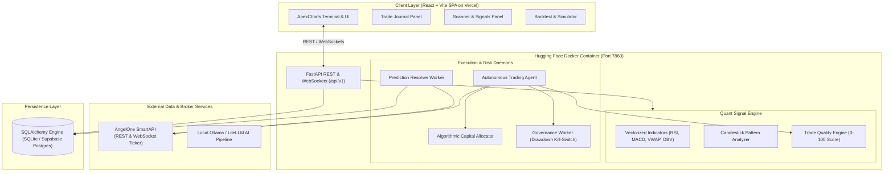

# 📈 ApexTrade AI Quant Engine & Real-Time Trading Server

[](https://apextrade-core-trade-ai-backend.hf.space)
[](https://github.com/junkportal05-a11y/trade-ai/actions/workflows/ci.yml)
[](https://www.python.org/)
[](https://fastapi.tiangolo.com/)
[](https://www.docker.com/)
[](LICENSE)

**ApexTrade** is an enterprise-grade quantitative trading engine and real-time market scanner designed for algorithmic trading, technical indicator computation, risk management, and strategy backtesting.

This repository powers the backend infrastructure hosted on **Hugging Face Spaces** as a containerized FastAPI Docker engine, connected to a React + Vite dashboard frontend on **Vercel**.

---

## 🚀 Live Demo

- **Live Space**: [https://apextrade-core-trade-ai-backend.hf.space](https://apextrade-core-trade-ai-backend.hf.space)
- **Interactive API Docs**: [https://apextrade-core-trade-ai-backend.hf.space/docs](https://apextrade-core-trade-ai-backend.hf.space/docs)
- **ReDoc**: [https://apextrade-core-trade-ai-backend.hf.space/redoc](https://apextrade-core-trade-ai-backend.hf.space/redoc)

<!-- Demo GIF -->
<p align="center">
  
</p>

<!-- One-command install -->
<p align="center">
  <kbd>
    <kbd>python</kbd>
    <kbd>-m</kbd>
    <kbd>venv</kbd>
    <kbd>.venv</kbd>
    <kbd>&&</kbd>
    <kbd>.venv\Scripts\activate</kbd>
    <kbd>&&</kbd>
    <kbd>pip</kbd>
    <kbd>install</kbd>
    <kbd>-r</kbd>
    <kbd>requirements.txt</kbd>
  </kbd>
</p>

<!-- CI badge -->
<p align="center">
  <a href="https://github.com/junkportal05-a11y/trade-ai/actions">
    
  </a>
</p>

<!-- Good first issue label -->
<p align="center">
  <a href="https://github.com/junkportal05-a11y/trade-ai/labels/good%20first%20issue">
    
  </a>
</p>

<!-- Social preview meta -->
<meta property="og:image" content="https://raw.githubusercontent.com/junkportal05-a11y/trade-ai/main/docs/demo/og-image.png" />
<meta property="og:title" content="ApexTrade AI Quant Engine - Real-time trading server" />
<meta property="og:description" content="Enterprise-grade quantitative trading engine with algorithmic trading, technical analysis, and backtesting." />
</p>

<!-- Plan to answer issues within a day -->
<p align="center">
  
</p>

<!-- Discussions enabled -->
<p align="center">
  <a href="https://github.com/junkportal05-a11y/trade-ai/discussions">
    
  </a>
</p>

---

## 📂 Repository Layout & Architecture

```text
trade ai/
├── main.py                     # Root application launcher (auto-detects .venv)
├── requirements.txt            # Unified, categorized Python dependencies
├── .env.example                # Blueprint for secrets, database & broker credentials
├── Dockerfile                  # Container definition for production / Hugging Face
├── docker-compose.yml          # Local container orchestration
│
├── backend/                    # Core FastAPI & Quantitative Trading Engine
│   ├── app/                    # REST APIs, routers, models, security & DB session
│   ├── quant/                  # Market regimes, correlation matrix & technical engines
│   ├── tests/                  # Unified automated test suite (285 passing tests)
│   ├── requirements.txt        # Synced Docker layer cache dependency file
│   └── trading_agent.py        # Autonomous trading agent daemon
│
├── frontend/                   # React + Vite Trading Dashboard
│   ├── src/                    # Components, state, charts & UI panels
│   ├── scripts/                # Frontend test runners (puppeteer, URL refactors)
│   ├── package.json            # NPM dependencies & scripts
│   └── vite.config.js          # Vite build configuration
│
├── docs/                       # Architecture & Engineering Documentation
│   ├── README.md               # Documentation directory index & navigation
│   ├── architecture.md         # 8-tier hierarchy, execution boundaries & daemons
│   ├── api-map.md              # REST & WebSocket endpoint catalogue
│   ├── database-map.md         # SQLAlchemy & Supabase schemas
│   └── incident-runbook.md     # Emergency kill-switch & recovery protocols
│
├── scripts/                    # Utility, Audit & Maintenance Tools
│   ├── README.md               # Script catalogue & usage guide
│   ├── audit.py                # Full codebase auditor
│   ├── benchmark.py            # Latency & throughput benchmarks
│   ├── proxy.bat               # OpenRouter proxy launcher
│   └── experimental/           # Isolated prototype tests & spikes
│
├── historical_data/            # Market candle caches (NIFTY50 & multi-timeframe)
├── knowledge/                  # Strategy manuals, guides & technical PDFs
├── notes/                      # Obsidian knowledge vault & memory logs
└── tools/                      # External plugins & assistant frameworks (caveman, claude-obsidian)
```

---

## 🏗️ Architecture Overview

ApexTrade separates quantitative market analysis, background signal daemons, and strategy execution from front-end visual rendering.



---

## ⚡ Bot Execution & Signal Validation Pipeline

```mermaid
flowchart LR
    Scan([Market Scan 09:15 AM]) --> Indicators[Vectorized Indicators]
    Indicators --> VWAPCheck{VWAP Veto Aligned?}
    VWAPCheck -->|No| Veto[Signal Vetoed]
    VWAPCheck -->|Yes| Quality[Trade Quality Score >= 70]
    Quality --> Alloc[Capital Allocator Position Sizing]
    Alloc --> Governance{Max Drawdown Safe?}
    Governance -->|Safe| Execute[Execute (Paper)]
    Governance -->|Unsafe| Halt[Kill-Switch Triggered]
    Execute --> Resolver[Prediction Resolver Monitor]
```

---

## 🧪 Hugging Face Quick Testing Guide (`curl`)

### 1. Check Space Health & Market Status
```bash
curl -X GET "https://apextrade-core-trade-ai-backend.hf.space/api/keepalive"
```

### 2. User Authentication (Obtain Bearer Token)
```bash
curl -X POST "https://apextrade-core-trade-ai-backend.hf.space/api/login" \
     -H "Content-Type: application/json" \
     -d '{"username": "code", "password": "YOUR_SECURE_PASSWORD"}'
```

### 3. Run Strategy Backtest Engine
```bash
curl -X POST "https://apextrade-core-trade-ai-backend.hf.space/api/backtest/run" \
     -H "Authorization: Bearer YOUR_ACCESS_TOKEN" \
     -H "Content-Type: application/json" \
     -d '{"symbol": "RELIANCE.NS", "timeframe": "1d", "initial_capital": 100000}'
```

---

## 🔒 Hugging Face Environment Variables (Space Secrets)

Configure the following secrets under **Space Settings -> Repository Secrets** on Hugging Face:

| Secret Key | Description | Example / Default |
|---|---|---|
| `DATABASE_URL` | SQLAlchemy Database URI | `sqlite:///trading_platform.db` or PostgreSQL URI |
| `JWT_SECRET` | Secret key for signing session JWT tokens | `your-256-bit-secret-key` |
| `ADMIN_KEY` | Header authentication key for admin endpoints | `admin_super_secret_key` |
| `ANGELONE_API_KEY` | AngelOne SmartAPI Key | `your_angelone_api_key` |
| `ANGELONE_CLIENT_ID` | AngelOne Broker User ID | `A123456` |
| `ANGELONE_PASSWORD` | AngelOne Account PIN / Password | `1234` |
| `ANGELONE_TOTP_KEY` | Secret seed key for 2FA TOTP generation | `BASE32_TOTP_SECRET` |
| `LITELLM_API_BASE` | Local Ollama / LiteLLM API base URL | `http://localhost:4000` |

---

## 📚 API Reference Overview

### 1. Authentication & Broker APIs
| Method | Endpoint | Description | Auth Required |
|---|---|---|---|
| `POST` | `/api/login` | Authenticate user & issue session token | No |
| `POST` | `/api/logout` | Invalidate active user session | Yes |
| `GET` | `/api/auth/verify` | Verify current session token validity | Yes |
| `POST` | `/api/angelone/login` | Connect to AngelOne SmartAPI broker | Yes |
| `GET` | `/api/angelone/status` | Check AngelOne connection state | Yes |

### 2. Market Data & Scanner APIs
| Method | Endpoint | Description | Auth Required |
|---|---|---|---|
| `GET` | `/api/quote` | Fetch live quote & depth for symbol | Yes |
| `GET` | `/api/history` | Retrieve historical OHLCV candles | Yes |
| `GET` | `/api/search` | Symbol & contract search lookup | Yes |
| `GET` | `/api/market_brief` | Retrieve overall market state & regime | Yes |
| `POST` | `/api/scan` | Trigger real-time scanner across NIFTY50 | Yes |
| `GET` | `/api/signals` | List active technical scanner signals | Yes |
| `POST` | `/api/allocate` | Calculate position sizing for signal | Yes |

### 3. Trade Predictions & Journal APIs
| Method | Endpoint | Description | Auth Required |
|---|---|---|---|
| `POST` | `/api/predictions` | Record new trade entry prediction | Yes |
| `GET` | `/api/predictions` | List active open and resolved trades | Yes |
| `GET` | `/api/predictions/stats` | Aggregated PnL, Win Rate, and metrics | Yes |
| `POST` | `/api/predictions/{id}/resolve` | Manually resolve open trade | Yes |
| `DELETE` | `/api/predictions/{id}` | Delete trade prediction record | Yes |
| `GET` | `/api/journal` | List user journal entries | Yes |
| `POST` | `/api/journal` | Create new trade journal log | Yes |
| `DELETE` | `/api/journal/{id}` | Delete journal log entry | Yes |

### 4. Backtest & Simulation APIs
| Method | Endpoint | Description | Auth Required |
|---|---|---|---|
| `POST` | `/api/backtest/run` | Execute historical backtest strategy | Yes |
| `GET` | `/api/backtest/stats` | Retrieve aggregate backtest performance | Yes |
| `GET` | `/api/backtest/history` | Retrieve backtest signal history | Yes |
| `POST` | `/api/backtest/reset` | Reset backtest data store | Yes (Admin) |

---

## 🛠️ Local Development & Quickstart

### Backend Setup (`/backend`)
```bash
cd backend
python -m venv .venv

# On Windows:
.venv\Scripts\activate
# On macOS/Linux:
source .venv/bin/activate

pip install -r requirements.txt
cp .env.example .env
uvicorn main:app --reload --port 8000
```

### Frontend Setup (`/frontend`)
```bash
cd frontend
npm install
npm run dev
```

### Tests & Verification
```bash
# Full backend suite (285 tests)
cd backend && python -m pytest -q

# Frontend unit tests + production build
cd frontend && npm test && npm run build
```

> **CI note:** `.github/workflows/ci.yml` executes 24 of the 48 backend test files
> plus a root-Dockerfile build + `GET /api/health/ping` smoke run and a
> frontend build check. Run the full suite locally before releasing; the CI
> job is not a complete regression gate.

---

## 📄 License & Security

- **License**: Released under the [MIT License](LICENSE).
- **Contributing**: Development guidelines in [CONTRIBUTING.md](CONTRIBUTING.md).
- **Security Policy**: Secret management and security reporting in [SECURITY.md](SECURITY.md).


---

## 🚀 Hugging Face Deployment ("hg" / "hf")

To deploy the latest code to the live Hugging Face Space:

```bash
# Automated deployment (handles commit-tree snapshot and skips legacy binary history):
python scripts/deploy_hf.py

# Dry-run check:
python scripts/deploy_hf.py --dry-run
```

> **Agent Note:** Direct `git push huggingface main` is blocked by Hugging Face's server hook due to binary files in past commits. `scripts/deploy_hf.py` creates a clean single commit on top of `huggingface/main` with the exact current `HEAD` tree.
