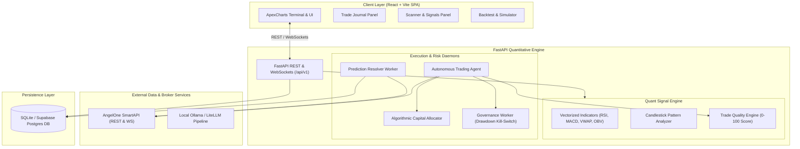
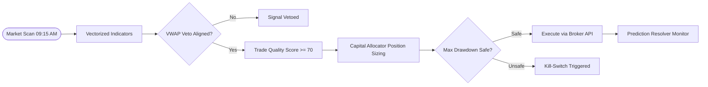

# ApexTrade Quant Server

[](https://github.com/apex-trade/trade-ai/actions/workflows/ci.yml)
[](https://www.python.org/)
[](https://fastapi.tiangolo.com/)
[](https://react.dev/)
[](https://vitejs.dev/)
[](LICENSE)

ApexTrade is an advanced quantitative trading platform designed for real-time market analysis, automated technical signal generation, portfolio capital allocation, and performance tracking.

This repository hosts the code for both the **FastAPI backend** (deployed as a Docker space on Hugging Face) and the **React + Vite frontend** (deployed on Vercel).

---

## Architecture Overview

ApexTrade uses a decoupled architecture separating data visualization and user interaction from heavy quantitative computation and broker background execution daemons.



*For detailed sequence diagrams and component specifications, check [architecture.md](architecture.md).*

---

## Bot Execution Pipeline



---

## API Reference

### 1. Authentication & Broker APIs
| Method | Endpoint | Description | Auth Required |
|---|---|---|---|
| `POST` | `/api/login` | Authenticate user & issue session token | No |
| `POST` | `/api/logout` | Invalidate active user session | Yes |
| `GET` | `/api/auth/verify` | Verify current session token validity | Yes |
| `POST` | `/api/angelone/login` | Connect to AngelOne SmartAPI broker | Yes |
| `GET` | `/api/angelone/status` | Check AngelOne connection state | Yes |

### 2. Market Data & Signals APIs
| Method | Endpoint | Description | Auth Required |
|---|---|---|---|
| `GET` | `/api/quote` | Fetch live quote & depth for symbol | Yes |
| `GET` | `/api/history` | Retrieve historical OHLCV candles | Yes |
| `GET` | `/api/search` | Symbol & contract search lookup | Yes |
| `GET` | `/api/market_brief` | Retrieve overall market state & regime | Yes |
| `POST` | `/api/scan` | Trigger real-time scanner across NIFTY50 | Yes |
| `GET` | `/api/signals` | List active technical scanner signals | Yes |
| `GET` | `/api/signal/{symbol}` | Fetch technical signal details for symbol | Yes |
| `POST` | `/api/allocate` | Calculate position sizing for signal | Yes |

### 3. Trade Predictions & Journal APIs
| Method | Endpoint | Description | Auth Required |
|---|---|---|---|
| `POST` | `/api/predictions` | Record new trade entry prediction | Yes |
| `GET` | `/api/predictions` | List active open and resolved trades | Yes |
| `GET` | `/api/predictions/stats` | Aggregated PnL, Win Rate, and metrics | Yes |
| `POST` | `/api/predictions/{id}/resolve` | Manually resolve open trade | Yes |
| `DELETE` | `/api/predictions/{id}` | Delete trade prediction record | Yes |
| `GET` | `/api/journal` | List user journal entries | Yes |
| `POST` | `/api/journal` | Create new trade journal log | Yes |
| `DELETE` | `/api/journal/{id}` | Delete journal log entry | Yes |

### 4. Backtest & Simulation APIs
| Method | Endpoint | Description | Auth Required |
|---|---|---|---|
| `GET` | `/api/backtest/run` | Execute historical backtest strategy | Yes |
| `GET` | `/api/backtest/stats` | Retrieve aggregate backtest performance | Yes |
| `GET` | `/api/backtest/history` | Retrieve backtest signal history | Yes |
| `POST` | `/api/backtest/reset` | Reset backtest data store | Yes (Admin) |

---

## Repository Structure

```directory
trade-ai/
├── backend/                  # FastAPI Python Backend
├── frontend/                 # React + Vite + Vanilla CSS Frontend
├── architecture.md           # Visual architecture & component specifications
├── routes.md                 # Route mapping documentation
├── CONTRIBUTING.md           # Development & PR guidelines
├── SECURITY.md               # Secret management & security policy
└── LICENSE                   # MIT License
```

---

## Local Setup & Quickstart

### 1. Backend Setup (`/backend`)
```bash
cd backend
python -m venv .venv

# On Windows:
.venv\Scripts\activate
# On macOS/Linux:
source .venv/bin/activate

pip install -r requirements.txt
cp .env.example .env
uvicorn main:app --reload --port 8000
```

### 2. Frontend Setup (`/frontend`)
```bash
cd frontend
npm install
npm run dev
```

---

## Community & Security

- **Contributing**: Please see [CONTRIBUTING.md](CONTRIBUTING.md) for setup and pull request guidelines.
- **Security Policy**: For secret management standards and reporting security issues, view [SECURITY.md](SECURITY.md).
- **License**: Released under the [MIT License](LICENSE).
