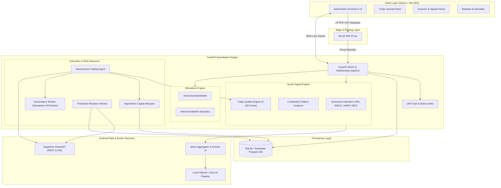
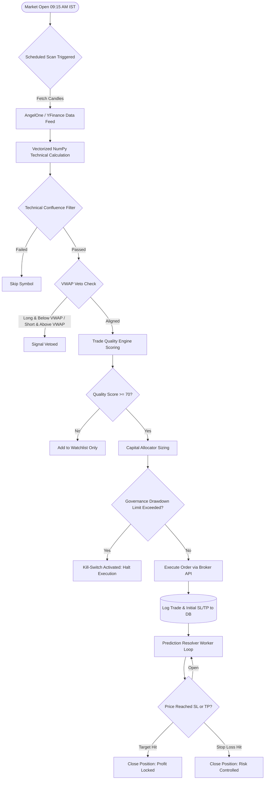
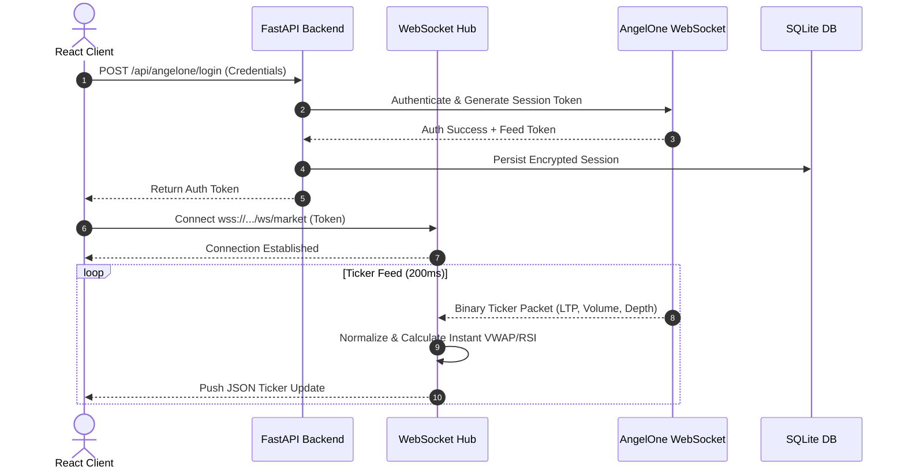

# ApexTrade Quant Server - System Architecture

ApexTrade is an end-to-end quantitative trading infrastructure for real-time market data streaming, technical signal generation, algorithmic capital allocation, automated trade execution, and performance tracking.

---

## 1. High-Level System Architecture

ApexTrade follows a modular split-service architecture separating data visualization and user interaction from heavy quantitative computation and broker background execution daemons.

---

## 2. Bot Execution Pipeline

The automated trading loop continuously scans instruments, scores technical setups, sizes risk, and monitors active trade exits.

---

## 3. Real-Time Data Streaming & WebSockets

Live market quotes flow from AngelOne SmartAPI WebSockets through the internal normalizer into the client dashboard.

---

## 4. Component Deep Dive

### 4.1 Market Data Layer
- **AngelOne SmartAPI Feed (`angelone_feed.py`)**: Broker REST & WebSocket client for fetching live market quotes, depth, and historical OHLCV data.
- **Data Mining Engine (`data_mining.py`)**: Fetches historical candlestick batches across NIFTY50 symbols and calculates base technical arrays.
- **News Sentiment Analyzer (`news_feed.py`)**: Aggregates market headlines and uses Google Gemini / local LiteLLM models to return sentiment confidence scores.

### 4.2 Quant Strategy & Signal Scoring
- **Signal Engine (`signals.py`)**: Fast NumPy-vectorized indicators:
  - **RSI (14)**: Momentum oscillator with overbought/oversold boundaries.
  - **MACD (12, 26, 9)**: Moving average convergence divergence histogram.
  - **VWAP**: Volume-Weighted Average Price benchmark.
  - **OBV**: On-Balance Volume accumulation line.
- **Candlestick Pattern Recognizer (`candlestick_patterns.py`)**: Vectorized detection of Doji, Hammer, Shooting Star, Bullish Engulfing, and Bearish Engulfing patterns.
- **Trade Quality Engine (`trade_quality.py`)**: Synthesizes indicator confluence, market regime, sentiment score, and candlestick patterns into a normalized quality score (0–100).

### 4.3 Execution & Risk Governance
- **Autonomous Agent (`trading_agent.py`)**: Background loop running during NSE market hours (09:15 to 15:20 IST) for automated scanning and order placement.
- **Capital Allocator (`capital_manager.py`)**: Calculates dynamic position sizing based on risk tiers:
  - **Elite Setup (Score 85–100)**: Allocates up to 1.0% account equity risk.
  - **Standard Setup (Score 70–84)**: Allocates 0.5% account equity risk.
  - **Low Setup (Score < 70)**: Flagged for manual review only.
- **Governance Worker (`governance_worker.py`)**: Enforces risk boundaries. If daily max drawdown exceeds the safety threshold (e.g., 3%), it triggers a global kill-switch halting all automated order placement.
- **Prediction Resolver (`main.py` -> `prediction_resolver_worker`)**: High-frequency loop monitoring open positions against real-time high/low candles to record stop loss and take profit resolutions accurately.

---

## 5. Technology Stack & Environment

| Layer | Technology |
|---|---|
| **Frontend UI** | React 19, Vite 8, Lightweight-Charts / ApexCharts, Vanilla CSS |
| **Backend Framework** | FastAPI 0.111, Uvicorn, Python 3.10+ |
| **Quant Computing** | NumPy, Pandas, PyArrow |
| **AI & LLM Pipeline** | Google GenAI SDK, Local Ollama / LiteLLM Offline Server |
| **Database** | SQLite ORM (`trade_ai.db`), Supabase Postgres |
| **Broker Integration** | AngelOne SmartAPI, yfinance fallback |
